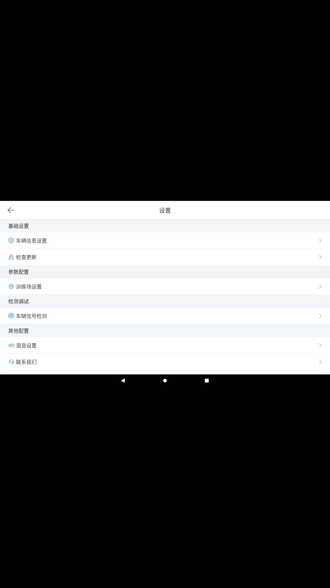

# 验证记录

日期：2026-10-14。输入为用户提供的 `jiakaoyi_coach_080359.apk.1.1`，SHA256：`a52da069ad1fa88a35923b003b68f4d9c240679d4cde386985999dff133a7349`。

## 已通过

| 检查 | 结果 | 证据 |
| --- | --- | --- |
| 原包签名 | apksigner 校验通过，v1/v2 有效；不是开发者身份认证 | `reports/original-signature.txt` |
| Smali 重建 | Apktool 3.0.3 成功重建全部 6 个 DEX | `scripts/build.py`，`reports/rebuilt-build-verification.json` |
| 类覆盖 | 33,298 个类定义；每个 DEX 的类描述符、方法引用和字段引用集合均与原包一致 | `reports/rebuilt-dex-identities.json` |
| Android 资源表 | 11,480 个 ID/类型/名称一致；忽略重编译后的文件路径和 public 标记后，配置与表值全部一致 | `reports/rebuilt-resource-coverage.json` |
| APK 成员追踪 | 3,408 个成员均已记录，无未映射成员；DEX、XML/资源表解码，其他载荷保留 | `reports/apk-entry-coverage.json` |
| 原样载荷 | 490 个非资源表/DEX/签名的成员与原包 SHA256 一致，包括 309 个 assets 和 42 个 `.so` | `reports/rebuilt-build-verification.json` |
| 托管程序集 | 105/105 个 DLL 已导出 C#，0 次导出失败；334 条显式 DLL 引用存在且为相对路径 | `reports/managed-full-export.json` |
| 对齐与签名 | zipalign 检查成功、apksigner 验证通过 | `reports/rebuilt-alignment.txt`，`reports/rebuilt-signature.txt` |

本地签名 APK：`jiakaoyi-coach-11.6.5-rebuilt-debug.apk`，111,990,129 字节。

SHA256：`a9e04523d27a7ffc58d87e7988fa49463764a9cf4ea12935e223f3986d1b2acb`。

上述校验不证明所有方法语义、SDK 服务、硬件交互或教学业务均已运行。资源文件可能经 AAPT2 重定位/重编码，重建包不是原包的逐字节副本。

## 安装与运行

在本次新建、已关闭网络的 Android 14 / API 34 ARM64 模拟器中，安装返回 `INSTALL_FAILED_NO_MATCHING_ABIS`。该模拟器的 `ro.product.cpu.abilist` 为 `arm64-v8a`，而原包的 42 个库全部为 `armeabi-v7a`。测试没有修改或使用用户现有 AVD。

随后下载了 Google 官方 Android 11 / API 30 ARM64 r16 镜像，并核对官方 SHA1 `0e66987d6b4db2e278af83d453ce5d74a7e6ced3`。镜像的 `build.prop` 同样声明 `ro.product.cpu.abilist=arm64-v8a`、`ro.product.cpu.abilist32=`，因此没有启动这个同样不兼容的镜像。

**本机测试结论：纯 ARM64 系统不兼容，未进入启动检查。** 本机安装尝试在 API 34 的纯 64 位环境被系统拒绝，目标 App 未执行。需要另有支持 `armeabi-v7a` 的安卓设备或系统；用户目前没有原运行设备。没有通过伪造 ABI 或删除原生库掩盖兼容问题。记录见 `reports/runtime-validation.json`。

Android 官方说明 API 31 及以上的模拟器系统镜像仅支持 64 位，见 [Support 64-bit architectures](https://developer.android.com/games/optimize/64-bit)。更早的 ARM64 镜像也必须检查其实际 ABI 列表，不能仅凭 Android 版本认定支持 ARM32。

## 云端重建与交付 APK

[构建运行 38519265729](https://github.com/onlyleida/JiaKaoBaoDianJiQiRen/actions/runs/38519265729) 使用提交 `52da4050a610ee243863fbfb64991d43f2d3596b`、Ubuntu 24.04 和 JDK 21 成功执行同一构建脚本。SDK 命令行工具从 [Android 官方下载页](https://developer.android.com/studio) 对应的固定版本下载并校验 SHA256。

Release 中的云端 APK 为 111,994,225 字节，SHA256：`a11eee996432ec7748761c684f223d3ba7eb2fb399d76a5b14dde4588d4e5180`。它使用云端新生成的调试证书，因此哈希和本地 APK 不同。

下载后再次验证 ZIP CRC、校验值、签名和 zipalign；490 个原始载荷 SHA256 均一致。六个 DEX、`resources.arsc` 和 `AndroidManifest.xml` 与本地已验证重建版本逐字节一致，因此上表的 DEX/资源内容校验也适用于本次云端文件。证据：`reports/ci-build-verification.json`、`reports/ci-download-verification.json`、`reports/ci-build-run.json`。

## 云端 Android 11 安装与启动

官方 `system-images;android-30;google_apis;x86` r16 实测 ABI 为 `x86,armeabi-v7a,armeabi`。在全新 AVD 中，安装前关闭无线网络并设置 IPv4/IPv6 OUTPUT 拒绝非 loopback 流量；安装返回 Success。

启动命令被系统接收，但目标进程随即 SIGSEGV。原生栈包含 `libndk_translation.so` 的 `ExecuteGuest`/`RunGuestCall`；45 秒后目标进程已不存在，前台为系统桌面。已查看 45 秒截图，未观察到应用正常首屏。仅凭此栈不能确定具体 ARM 库或把问题完全归因于模拟器；[Android 官方已记录部分 ARMv7 二进制在 Android 11 转译镜像上失败](https://developer.android.com/studio/releases/emulator#support_for_arm_binaries_on_android_9_and_11_system_images)。

报告和原生崩溃栈：`reports/ci-runtime-api30-verification.json`、`reports/ci-runtime-api30-crash.txt`。完整日志和截图在 Release 的 `ci-runtime-evidence.zip`。`evidence_collected` / 绿色工作流表示采集完成，不代表启动或完整教学功能通过。

## 云端 Android 9 对照检查

[最终检查 38520513285](https://github.com/onlyleida/JiaKaoBaoDianJiQiRen/actions/runs/38520513285) 复用上述同一 APK，不重新打包。官方 API 28 Google APIs x86 镜像实测同样包含 `armeabi-v7a`；安装返回 Success。启动命令等待 60 秒超时，随后继续采集。

已查看截图：只有白色画面和 Android 导航栏。原始报告虽然在采样瞬间获得 PID，并记录目标 Activity 为 resumed，但日志显示目标进程反复退出（Zygote 退出码 1）并被重新拉起，因此不能把单次 PID/前台状态当作稳定运行。该轮 crash buffer 没有目标包记录，也不能据此声称应用正常；捕获的 tombstone 属于系统 SurfaceFlinger，不能归为目标应用崩溃。

`screen-after-10s/45s` 的时间以启动命令返回或超时后开始计算。报告：`reports/ci-runtime-api28-verification.json`；综合判读：`reports/ci-runtime-review.json`。完整原始证据和截图在 Release 的 `ci-runtime-api28-evidence.zip`。

**2026-10-14 普通重建包结论：APK 内部内容已完整提取并重建，签名、资源/DEX 内容和安装通过；两个云端转译环境均未进入正常应用首屏，完整教学功能未验证。** 当前证据不足以判定具体原生库、签名检查或转译兼容问题的根因。用户没有原运行设备，后续仍需真正支持 ARM32 的设备或可正常执行这些原生库的环境，以及包外资源/硬件/后台才能继续功能验证。

## 保留的边界

Java 导出不是经过修复的可编译源码；C# 项目没有源码构建验证；原生库保留二进制。原厂签名私钥、服务端和包外 Unity/场地资源未取得。运行依赖见 [RUNTIME_DEPENDENCIES.md](RUNTIME_DEPENDENCIES.md)。

## 2026-10-15 模拟器兼容修复及真实页面验证

[运行 38597306444](https://github.com/onlyleida/JiaKaoBaoDianJiQiRen/actions/runs/38597306444) 使用提交 `5b71a1893782008016c9aa76e67d79a0f09a3758`，环境为 Android 9 / API 28 Google APIs x86，实际具备 ARM32 转译。安装包为 `jiakaoyi-coach-11.6.5-emulator-api28-debug.apk`，111,990,129 字节，SHA256：

`bbc2b51c01f57fba8f50ec8fd688cbf42baddb153eade0f5dd3c27bb253e49ac`

已实际修复 OpenSSL CPU 探测和重签名后的 native 证书允许列表问题。API 30 后续仍分别在讯飞语音和 PAG 动画转译中崩溃，因此最终采用 API 28，保留原语音 SDK 初始化。只在独立覆盖副本修改 1 个 SO 的两个范围、23 个 API 主机方法、普通表单开关、本地 ping 目标及原有蓝牙模拟开关缺省值；仓库原始 `android/` 树与最初导入逐项 Git 比较无差异。

实际结果：

- 安装、签名、ZIP CRC、对齐及下载 SHA256 复核通过。489 个原始保留载荷仍逐字节一致；1 个 native 库的声明修改范围及证书匹配单独验证，不误称全部 490 项未修改。
- 完成隐私确认及系统录屏确认。同一主进程 PID 4652 在首次与 67.7 秒采样一致；随后打开设置、点击语音设置并返回，PID 仍一致。完整日志无该进程退出，两次 crash buffer 均为空。
- 已人工查看真实截图：原生设置菜单、原生语音设置页和返回后的设置页均正常显示。设置通过 root ADB 显式启动原有 SettingActivity，菜单点击则打开原有 TtsSettingActivity。
- 原 `libmsc.so` 确实加载，未停用语音初始化；未点击试听、下载语音包或验证识别结果，不能据此声称语音效果可用。
- 12 条实际业务请求中 11 条 HTTP 200；唯一 401 是未登录会话检查（客户端错误码44），没有其他业务错误。包括配置保存、登录配置、地区代码、APP/固件更新、Unity更新及日志记录。
- 正常启动到达“Unity包加载失败”对话框；源码对应 type100 / 80% 阶段。后台明确没有100/101包，无法进入完整教学首页。没有用假文件或删除检查掩盖缺失资源。
- 全程阻止 guest 非回环 IPv4/IPv6，只允许通过 adb reverse 访问本地服务，未访问原厂服务。真实车辆硬件和完整登录/教学业务未验证。

完整判读见 `reports/emulator-runtime-review.json`；原始自动报告保留 `first_screen_verified=false` 的未人工判读缺省值，人工截图判断单独记录，不篡改原始证据。Release 中 `emulator-api28-runtime-evidence.zip` 保存本轮完整日志、XML、截图和构建记录。

复现和完整兼容变体边界见 [EMULATOR.md](EMULATOR.md)。
